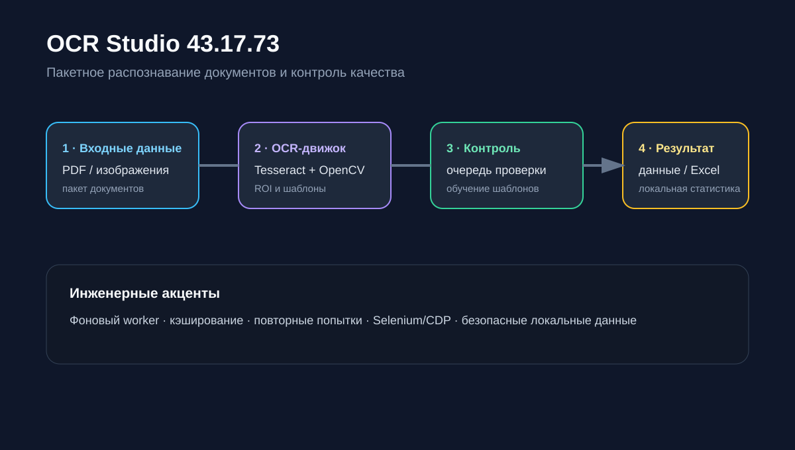

# OCR Studio

**Рабочее Windows-приложение для автоматизации обработки документов: пакетный OCR → проверка полей → автоматизация дальнейшего внесения.**

Программа обрабатывает PDF и изображения, распознаёт ФИО и номера помещений, поддерживает обучаемые зоны и библиотеку шаблонов. Сомнительные результаты направляются на ручную проверку; для рабочего сценария предусмотрена автоматизация через Chrome/Selenium.

**Опубликованный релиз:** [v43.17.73](https://github.com/alexandrela191-hub/OCR-Studio/releases/tag/v43.17.73).

## Что я сделал

- Реализовал пакетную обработку PDF и изображений с извлечением ФИО и номеров помещений.
- Добавил обучаемые зоны, библиотеку шаблонов и поиск дублирующихся шаблонов.
- Организовал ручную проверку сомнительных результатов и разделил этапы распознавания, проверки и внесения.
- Реализовал фоновую обработку с повторным использованием OCR worker-процесса.
- Добавил локальную статистику, восстановление незавершённой сессии и автоматизацию через Selenium.

## Результат работы

Оператор получает единый инструмент для обработки партии документов, проверки распознанных полей и последующей автоматизации рабочего сценария. Архитектурная схема и инструкция запуска приведены ниже.

## Рабочая версия и портфолио-демо

Этот репозиторий содержит исходный код основного приложения. Рабочие документы, шаблоны, сессии, журналы, локальные настройки и данные авторизации исключены из публикации. Настройка рабочего сценария выполняется в соответствующей среде.

Для знакомства с основными этапами без рабочего портала доступен [самостоятельный OCR demo](https://github.com/alexandrela191-hub/01-ocr-document-automation): извлечение полей, подтверждение оператором, безопасное сохранение и локальная имитация робота. Демо создано по мотивам v43.17.49 и не воспроизводит все возможности текущего OCR Studio.

## Возможности

- пакетная обработка PDF и изображений;
- распознавание ФИО и номеров помещений;
- обучаемые зоны распознавания и библиотека шаблонов;
- очередь ручной проверки сомнительных результатов;
- поиск и удаление дублирующихся шаблонов;
- фоновая OCR-обработка с повторным использованием worker-процесса;
- автоматизация рабочего сценария через Chrome/Selenium;
- локальная статистика и восстановление незавершённой сессии.

## Что изменилось в 43.17.73

- восстановление ФИО, в котором первая буква фамилии ошибочно распознана строчной;
- более точный поиск номера квартиры в комбинированной строке с квартирой, машино-местом и комнатой;
- поддержка двухсловных ФИО в обученной зоне или найденной строке собственника;
- ускоренные ROI для бланка 101;
- сохранена проверенная логика внесения из версии 43.17.60.

## Запуск

Требуются Windows, Python 3.11+ и установленный Tesseract OCR.

```powershell
python -m venv .venv
.\.venv\Scripts\Activate.ps1
pip install -r requirements.txt
python ocr_studio.py
```

Для преобразования PDF также нужен Poppler. Путь к Tesseract и рабочие каталоги настраиваются локально в приложении.

## Технологии

Python, Tkinter, Tesseract OCR, OpenCV, Pillow, Selenium, NumPy и OpenPyXL.



## Структура

- `ocr_studio.py` — приложение и OCR-движок;
- `requirements.txt` — Python-зависимости;
- `.gitignore` — исключение рабочих документов, кэшей и локальных настроек.

## Конфиденциальность

Репозиторий содержит только исходный код. Рабочие документы, OCR-сессии, шаблоны, журналы, настройки и данные авторизации намеренно исключены.
